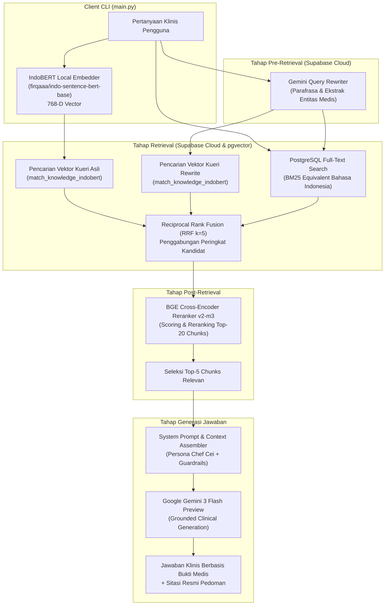

# LAMPIRAN TUGAS AKHIR
**PENGEMBANGAN CHATBOT KONSULTASI GIZI KLINIS BERBASIS ADVANCED RETRIEVAL-AUGMENTED GENERATION (RAG) MENGGUNAKAN INDOBERT DAN GOOGLE GEMINI**

- **Repositori Resmi GitHub:** [https://github.com/inceiqbals6-prog/chatbot-konsultasi-gizi](https://github.com/inceiqbals6-prog/chatbot-konsultasi-gizi)
- **Model Generasi (LLM):** Google Gemini 3 Flash Preview (`gemini-3-flash-preview`)
- **Model Embedding:** IndoBERT (`firqaaa/indo-sentence-bert-base`, 768 Dimensi)
- **Model Reranker:** BGE Cross-Encoder Reranker (`BAAI/bge-reranker-v2-m3`)
- **Basis Data Vektor:** PostgreSQL dengan Ekstensi `pgvector` (Supabase Cloud)

---

## DAFTAR ISI LAMPIRAN
1. [Lampiran A — Kode Program dan Repositori](#lampiran-a--kode-program-dan-repositori)
   - A.1 Informasi Repositori & Spesifikasi Lingkungan
   - A.2 Konfigurasi Model & Parameter Sistem
   - A.3 Implementasi Antarmuka CLI Interaktif (`main.py`)
   - A.4 Implementasi Arsitektur Retrieval 5 Konfigurasi RAG (`retrieval.ts`)
   - A.5 Implementasi Query Rewriting (`query_rewrite.ts`)
   - A.6 Implementasi Cross-Encoder Reranker (`reranker.ts`)
2. [Lampiran B — Data Pengujian (15 Clinical Vignettes)](#lampiran-b--data-pengujian-15-clinical-vignettes)
   - B.1 Matriks 15 Skenario Kasus Klinis
   - B.2 Rincian Spesifikasi Kueri, Ground Truth, dan Dokumen Rujukan (V01 - V15)
3. [Lampiran C — Hasil Pengujian Lengkap (75 Evaluasi)](#lampiran-c--hasil-pengujian-lengkap-75-evaluasi)
   - C.1 Ringkasan Eksekutif Metrik RAGAS Berdasarkan 5 Mode Arsitektur
   - C.2 Hasil Evaluasi Mean Reciprocal Rank (MRR) dan Hit Rate
   - C.3 Tabel Rincian Lengkap 75 Entri Evaluasi RAGAS (GPT-4o Judge)
   - C.4 Analisis Performa Komparatif 5 Mode per Kasus Klinis
4. [Lampiran D — Dokumentasi Sistem dan Antarmuka](#lampiran-d--dokumentasi-sistem-dan-antarmuka)
   - D.1 Diagram Alur Arsitektur Sistem (Pipeline RAG End-to-End)
   - D.2 Panduan Menjalankan Sistem untuk Penguji
   - D.3 Dokumentasi Tampilan Antarmuka CLI Terminal
   - D.4 Transkrip Contoh Konsultasi Klinis (Kasus Diabetes, Hipertensi, dan PGK)
   - D.5 Dokumentasi Pelaksanaan Eksperimen Otomatis (`evaluasi.py`)

---

# LAMPIRAN A — KODE PROGRAM DAN REPOSITORI

### A.1 Informasi Repositori & Spesifikasi Lingkungan
- **Tautan Repositori:** `https://github.com/inceiqbals6-prog/chatbot-konsultasi-gizi`
- **Lisensi:** MIT License / Academic Research Only
- **Bahasa Pemrograman:** Python 3.10+ (Client CLI & Evaluasi), TypeScript / Deno (Backend Edge Functions), PL/pgSQL (Basis Data Vektor)
- **Dependensi Utama Python (`requirements.txt`):**
  ```txt
  requests>=2.31.0
  pandas>=2.0.0
  numpy>=1.24.0
  torch>=2.0.0
  transformers>=4.30.0
  ```

### A.2 Konfigurasi Model & Parameter Sistem
| Komponen | Spesifikasi / Model | Parameter / Dimensi | Sumber / Penyedia |
| :--- | :--- | :--- | :--- |
| **Model LLM Generasi** | Google Gemini 3 Flash Preview | Temperature: 0.4, Max Tokens: 8192 | Google Cloud / AI Studio |
| **Model Embedding Kueri & Dokumen** | `firqaaa/indo-sentence-bert-base` | 768 Dimensi, Mean Pooling, L2 Normalization | Hugging Face Hub / PyTorch |
| **Model Reranker Dokumen** | `BAAI/bge-reranker-v2-m3` | Cross-Encoder Logits, Cut-off Top-5 | BAAI / Hugging Face Router |
| **Mesin Pencarian Leksikal** | PostgreSQL Full-Text Search (BM25 Equivalent) | Kamus: `indonesian`, Limit: 20 Chunks | PostgreSQL Cloud (Supabase) |
| **Metode Fusi Multi-Jalur** | Reciprocal Rank Fusion (RRF) | Konstanta $k = 5$ | Custom Algoritma |

---

### A.3 Implementasi Antarmuka CLI Interaktif (`main.py`)
File ini menyediakan antarmuka baris perintah (*Command Line Interface*) bagi penguji untuk berinteraksi langsung dengan chatbot menggunakan kueri bebas pada 5 variasi ablasi RAG:

```python
import os
import sys
import uuid
import warnings
import logging
import threading

# Hilangkan log peringatan unauthenticated HF Hub dan progress bar
threading.excepthook = lambda args: None
os.environ["HF_HUB_DISABLE_PROGRESS_BARS"] = "1"
os.environ["TRANSFORMERS_NO_ADVISORY_WARNINGS"] = "1"
os.environ["HF_HUB_DISABLE_SYMLINKS_WARNING"] = "1"
os.environ["TOKENIZERS_PARALLELISM"] = "false"
warnings.filterwarnings("ignore")
logging.getLogger("transformers").setLevel(logging.ERROR)
logging.getLogger("huggingface_hub").setLevel(logging.ERROR)

try:
    from transformers import logging as tf_logging
    tf_logging.set_verbosity_error()
except Exception:
    pass

import requests

DEFAULT_SUPABASE_URL = "https://zfiyfhmsuhitytsuioml.supabase.co"
DEFAULT_USER_EMAIL = "evaluator@example.com"
DEFAULT_EMBEDDING_ENGINE = "indobert"
INDOBERT_MODEL_NAME = "firqaaa/indo-sentence-bert-base"

SUPABASE_URL = os.getenv("SUPABASE_URL", DEFAULT_SUPABASE_URL)
ANON_KEY = os.getenv("SUPABASE_ANON_KEY", "")
SERVICE_ROLE_KEY = os.getenv("SUPABASE_SERVICE_ROLE_KEY", "")

def load_local_env():
    global ANON_KEY, SERVICE_ROLE_KEY, SUPABASE_URL
    paths = [
        os.path.join(os.path.dirname(__file__), ".env"),
        os.path.join(os.path.dirname(__file__), "supabase", "functions", "gemini-proxy", "scripts", ".env"),
    ]
    for p in paths:
        if os.path.exists(p):
            try:
                with open(p, "r", encoding="utf-8") as f:
                    for line in f:
                        line = line.strip()
                        if "=" in line and not line.startswith("#"):
                            k, v = line.split("=", 1)
                            k, v = k.strip(), v.strip().strip('"').strip("'")
                            if k in ["SUPABASE_KEY", "SUPABASE_ANON_KEY"] and not ANON_KEY:
                                ANON_KEY = v
                            elif k == "SUPABASE_SERVICE_ROLE_KEY" and not SERVICE_ROLE_KEY:
                                SERVICE_ROLE_KEY = v
                            elif k == "SUPABASE_URL" and SUPABASE_URL == DEFAULT_SUPABASE_URL:
                                SUPABASE_URL = v
            except Exception:
                pass

load_local_env()

_indobert_tokenizer = None
_indobert_model = None
_indobert_available = None

def init_indobert():
    global _indobert_tokenizer, _indobert_model, _indobert_available
    if _indobert_available is not None:
        return _indobert_available
    try:
        import torch
        from transformers import AutoTokenizer, AutoModel

        print("Memuat model IndoBERT (firqaaa/indo-sentence-bert-base)...", end=" ", flush=True)
        try:
            _indobert_tokenizer = AutoTokenizer.from_pretrained(INDOBERT_MODEL_NAME, local_files_only=True)
            _indobert_model = AutoModel.from_pretrained(INDOBERT_MODEL_NAME, local_files_only=True)
        except Exception:
            _indobert_tokenizer = AutoTokenizer.from_pretrained(INDOBERT_MODEL_NAME)
            _indobert_model = AutoModel.from_pretrained(INDOBERT_MODEL_NAME)

        _indobert_model.eval()
        _indobert_available = True
        device = "cuda" if torch.cuda.is_available() else "cpu"
        print(f"[Siap - {device.upper()}]")
    except Exception as e:
        _indobert_available = False
        print(f"[Offline fallback aktif: {e}]")
    return _indobert_available

def get_indobert_embedding(text: str):
    if not init_indobert():
        return None
    try:
        import torch
        import torch.nn.functional as F
        enc = _indobert_tokenizer([str(text)], padding=True, truncation=True, max_length=512, return_tensors='pt')
        with torch.no_grad():
            out = _indobert_model(**enc)
        mask = enc['attention_mask'].unsqueeze(-1).expand(out[0].size()).float()
        mean_pooled = torch.sum(out[0] * mask, 1) / torch.clamp(mask.sum(1), min=1e-9)
        emb = F.normalize(mean_pooled, p=2, dim=1)[0].tolist()
        return emb
    except Exception:
        return None

RAG_MODES = {
    "1": ("advanced", "Full Advanced RAG (Query Rewriting + Hybrid RRF + BGE Reranker)"),
    "2": ("post_retrieval", "Post-Retrieval Only (BGE Cross-Encoder Reranker)"),
    "3": ("pre_retrieval", "Pre-Retrieval Only (Query Rewriting + Hybrid RRF)"),
    "4": ("naive", "Naive RAG (Pencarian Vektor Standar)"),
    "5": ("none", "LLM Baseline (Tanpa Retrieval)")
}

def get_auth_token():
    if not SERVICE_ROLE_KEY or not ANON_KEY:
        return None
    try:
        admin_headers = {
            "apikey": SERVICE_ROLE_KEY,
            "Authorization": f"Bearer {SERVICE_ROLE_KEY}",
            "Content-Type": "application/json"
        }
        res = requests.post(
            f"{SUPABASE_URL}/auth/v1/admin/generate_link",
            headers=admin_headers,
            json={"type": "magiclink", "email": DEFAULT_USER_EMAIL},
            timeout=15
        )
        token_hash = res.json().get("hashed_token")
        if not token_hash:
            return None

        verify_res = requests.post(
            f"{SUPABASE_URL}/auth/v1/verify",
            headers={"apikey": ANON_KEY, "Content-Type": "application/json"},
            json={"type": "magiclink", "token_hash": token_hash},
            timeout=15
        )
        return verify_res.json().get("access_token")
    except Exception:
        return None

def choose_configuration():
    print("\nPilih Konfigurasi RAG:")
    for k, v in RAG_MODES.items():
        prefix = "[1] (Default)" if k == "1" else f"[{k}]"
        print(f"  {prefix} {v[1]}")
    choice = input("Pilihan [1-5, default=1]: ").strip()
    return RAG_MODES[choice] if choice in RAG_MODES else RAG_MODES["1"]

def main():
    print("=" * 60)
    print("Chatbot Konsultasi Gizi Medis (CLI)")
    print(f"Embedding Engine: IndoBERT ({INDOBERT_MODEL_NAME})")
    print("=" * 60)

    if not ANON_KEY:
        print("\n[PERINGATAN] Berkas .env atau SUPABASE_ANON_KEY belum dikonfigurasi.")
        print("Silakan buat berkas .env (contoh: salin dari .env.example) dan isi kredensial Supabase Anda.")
        print("Program dihentikan untuk mencegah akses tidak sah ke kuota API.")
        return

    mode, mode_label = choose_configuration()
    session_id = f"cli-{uuid.uuid4().hex[:8]}"

    token = get_auth_token() or ANON_KEY

    print("\n" + "-" * 60)
    print(f"Konfigurasi aktif : {mode_label}")
    print(f"Model Embedding   : IndoBERT ({INDOBERT_MODEL_NAME})")
    print("Ketik pertanyaan klinis Anda, 'mode' untuk ganti konfigurasi, atau 'keluar' untuk selesai.")
    print("-" * 60)

    if mode != "none":
        init_indobert()

    while True:
        try:
            user_input = input("\nUser: ").strip()
        except (KeyboardInterrupt, EOFError):
            print("\nSelesai.")
            break

        if not user_input:
            continue

        if user_input.lower() in ["keluar", "exit", "quit", "q"]:
            print("Selesai.")
            break

        if user_input.lower() == "mode":
            mode, mode_label = choose_configuration()
            print(f"\nMode diperbarui: {mode_label}")
            if mode != "none":
                init_indobert()
            continue

        query_emb = None
        if mode != "none":
            query_emb = get_indobert_embedding(user_input)

        headers = {
            "apikey": ANON_KEY,
            "Authorization": f"Bearer {token}",
            "Content-Type": "application/json"
        }
        payload = {
            "action": "chatbot",
            "userMessage": user_input,
            "rag_mode": mode,
            "embedding_engine": DEFAULT_EMBEDDING_ENGINE,
            "session_id": session_id,
            "app_version": "cli-1.0.0"
        }
        if query_emb:
            payload["query_embedding"] = query_emb

        try:
            resp = requests.post(f"{SUPABASE_URL}/functions/v1/gemini-proxy", headers=headers, json=payload, timeout=60)
            if resp.status_code == 200:
                data = resp.json()
                print(f"\nChatbot:\n{data.get('result', 'Tidak ada respon teks.')}")
            else:
                print(f"\nError {resp.status_code}: {resp.text[:200]}")
        except Exception as e:
            print(f"\nError koneksi: {e}")

if __name__ == "__main__":
    main()
```

---

### A.4 Implementasi Arsitektur Retrieval 5 Konfigurasi RAG (`retrieval.ts`)
Potongan kode backend TypeScript yang mengeksekusi fusi pencarian vektor IndoBERT, pencarian leksikal BM25, dan pengurutan RRF:

```typescript
export async function retrieveContext(
    supabaseService: SupabaseClient,
    userMessage: string,
    apiKey: string,
    ragMode: RagMode,
    runId: string,
    secondaryQuery?: string,
    originalUserMessage?: string,
    embeddingEngine: EmbeddingEngine = 'indobert',
    clientQueryEmbedding?: number[]
): Promise<RAGDocument[]> {
    const isAdvancedLike = ragMode === 'advanced' || ragMode === 'pre_retrieval'
    const fetchTarget = ragMode === 'post_retrieval' ? RAG_RERANK_CANDIDATE_COUNT : RAG_MATCH_COUNT
    const matchThreshold = isAdvancedLike || ragMode === 'post_retrieval' ? RAG_ADVANCED_THRESHOLD : RAG_MATCH_THRESHOLD
    const rpcName = embeddingEngine === 'indobert' ? 'match_knowledge_indobert' : 'match_knowledge'

    // 1. Eksekusi Naive RAG / Post-Retrieval Single Dense Vector
    if (ragMode === 'naive' || ragMode === 'post_retrieval') {
        const queryEmbedding = (clientQueryEmbedding && clientQueryEmbedding.length > 0)
            ? clientQueryEmbedding
            : await generateIndoBertEmbedding(userMessage, runId)

        if (queryEmbedding) {
            const { data, error } = await supabaseService.rpc(rpcName, {
                query_embedding: `[${queryEmbedding.join(',')}]`,
                match_count: fetchTarget,
                match_threshold: matchThreshold,
            })
            if (!error && data && data.length > 0) return data as RAGDocument[]
        }
    }

    // 2. Eksekusi Pre-Retrieval & Full Advanced RAG: True 3-Way Hybrid Retrieval
    const origQueryText = originalUserMessage || userMessage
    const rewrQueryText = secondaryQuery || userMessage

    // Jalur A: Vektor Kueri Asli (IndoBERT)
    let denseOrigDocs: RAGDocument[] = []
    const origEmbedding = clientQueryEmbedding || await generateIndoBertEmbedding(origQueryText, runId)
    if (origEmbedding) {
        const { data } = await supabaseService.rpc(rpcName, {
            query_embedding: `[${origEmbedding.join(',')}]`,
            match_count: RAG_INITIAL_FETCH_COUNT,
            match_threshold: matchThreshold,
        })
        if (data) denseOrigDocs = data as RAGDocument[]
    }

    // Jalur B: Vektor Kueri Hasil Rewrite (IndoBERT)
    let denseRewrDocs: RAGDocument[] = []
    if (rewrQueryText !== origQueryText) {
        const rewrEmbedding = await generateIndoBertEmbedding(rewrQueryText, runId)
        if (rewrEmbedding) {
            const { data } = await supabaseService.rpc(rpcName, {
                query_embedding: `[${rewrEmbedding.join(',')}]`,
                match_count: RAG_INITIAL_FETCH_COUNT,
                match_threshold: matchThreshold,
            })
            if (data) denseRewrDocs = data as RAGDocument[]
        }
    }

    // Jalur C: Pencarian Leksikal BM25 (PostgreSQL Full-Text Search)
    const termsToSearch = extractClinicalKeywords(origQueryText, rewrQueryText).slice(0, 6)
    const kwResults = await Promise.all(
        termsToSearch.map(term =>
            supabaseService
                .from('knowledge_base')
                .select('id, category, title, content, source, metadata')
                .textSearch('content', term, { config: 'indonesian', type: 'plain' })
                .limit(BM25_FETCH_COUNT)
        )
    )
    const bm25Docs = dedupeDocs(kwResults.flatMap(r => r.data || []))

    // 3. Fusi Multi-Jalur dengan Reciprocal Rank Fusion (RRF k=5)
    const allCandidates = dedupeRagDocuments([...denseOrigDocs, ...denseRewrDocs, ...bm25Docs])
    const fusedDocs = allCandidates.map(doc => {
        let rrfScore = 0
        const rOrig = rankOrigMap.get(getRagDocKey(doc))
        const rRewr = rankRewrMap.get(getRagDocKey(doc))
        const rBm25 = rankBm25Map.get(getRagDocKey(doc))
        if (rOrig !== undefined) rrfScore += 1 / (5 + rOrig)
        if (rRewr !== undefined) rrfScore += 1 / (5 + rRewr)
        if (rBm25 !== undefined) rrfScore += 1 / (5 + rBm25)
        return { ...doc, rrf_score: rrfScore }
    })

    fusedDocs.sort((a, b) => (b.rrf_score ?? 0) - (a.rrf_score ?? 0))
    const targetCandidateCount = ragMode === 'pre_retrieval' ? RAG_MATCH_COUNT : RAG_RERANK_CANDIDATE_COUNT
    return fusedDocs.slice(0, targetCandidateCount)
}
```

---

# LAMPIRAN B — DATA PENGUJIAN (15 CLINICAL VIGNETTES)

### B.1 Matriks 15 Skenario Kasus Klinis
| ID | Tipe | Domain Penyakit | Dokumen Ground Truth Resmi | Target Chunk ID | Halaman Dokumen |
| :---: | :---: | :--- | :--- | :---: | :---: |
| **V01** | Eksplisit | Hipertensi | `PNPK 2021 - Tata Laksana Hipertensi Dewasa.pdf` | `46` | Hal. 26 - 27 |
| **V02** | Eksplisit | Penyakit Ginjal Kronik (PGK-HD) | `KONSENSUS NUTRISI PENYAKIT GINJAL KRONIK.pdf` | `30` | Hal. 11 (Cetak) |
| **V03** | Eksplisit | Obesitas Dewasa | `KONSENSUS TATA LAKSANA MULTIDISIPLIN OBESITAS PADA DEWASA 2025.pdf` | `104, 105` | Hal. 34 - 35 |
| **V04** | Implisit | Hipertensi & Natrium (MSG) | `PNPK 2021 - Tata Laksana Hipertensi Dewasa.pdf` | `43, 44` | Hal. 25 - 26 |
| **V05** | Implisit | Diabetes Melitus (Jus Buah) | `PNPK Tata Laksana Diabetes Melitus Tipe 2 Dewasa.pdf` | `52` | Hal. 26 - 27 |
| **V06** | Eksplisit | Diabetes Melitus (Diet Mediterania) | `Perkeni Dewasa 2024.pdf` | `120` | Hal. 56 - 57 |
| **V07** | Implisit | Dislipidemia & Lemak Trans | `23-11-21-Panduan-Dislipidemia-2021-Ebook.pdf` | `44, 45` | Hal. 14 - 15 |
| **V08** | Eksplisit | Dislipidemia (Serat Larut) | `23-11-21-Panduan-Dislipidemia-2021-Ebook.pdf` | `43, 44` | Hal. 14 - 15 |
| **V09** | Eksplisit | Diabetes Melitus & Obesitas | `PNPK Tata Laksana Malnutrisi Pada Dewasa.pdf` | `188` | Hal. 106 |
| **V10** | Eksplisit | PGK Anak (Defisiensi Vitamin D) | `PNPK Tata Laksana Penyakit Ginjal Kronik Tahun 2023.pdf` | `102, 103` | Hal. 50 - 51 |
| **V11** | Eksplisit | Diabetes Melitus (Puasa Ramadhan) | `PNPK Tata Laksana Diabetes Melitus Tipe 2 Dewasa.pdf` | `234` | Hal. 105 |
| **V12** | Implisit | PGK Stadium 4 & Volume Cairan | `PNPK Tata Laksana Penyakit Ginjal Kronik Tahun 2023.pdf` | `45, 46` | Hal. 25 - 26 |
| **V13** | Eksplisit | Osteoporosis (Kalsium) | `PNPK Tata Laksana Osteoporosis.pdf` | `115` | Hal. 45 - 46 |
| **V14** | Eksplisit | Penyakit Ginjal Diabetik (Protein) | `Perkeni Dewasa 2024.pdf` | `185` | Hal. 93 |
| **V15** | Implisit | Obesitas & Radang Hati (MAFLD) | `KONSENSUS TATA LAKSANA MULTIDISIPLIN OBESITAS PADA DEWASA 2025.pdf` | `89` | Hal. 29 |

---

### B.2 Rincian Spesifikasi Kueri, Ground Truth, dan Dokumen Rujukan (V01 - V15)

#### V01 — Hipertensi: Makronutrien Pola Diet DASH (Eksplisit)
- **Pertanyaan Pasien:** *"Saya penderita hipertensi dan sedang mencoba diet DASH, bagaimana anjuran pembagian persentase porsi karbohidrat, lemak, dan protein yang tepat untuk kebutuhan harian saya?"*
- **Dokumen Rujukan:** `PNPK 2021 - Tata Laksana Hipertensi Dewasa.pdf`, Tabel 12 & Tabel 13.
- **Target Chunk ID:** `['46']`
- **Kunci Jawaban Referensi:** Rekomendasi komposisi makronutrien pola diet DASH adalah karbohidrat 55%, lemak 27% (lemak jenuh dibatasi 6%), dan protein 18% dari total energi harian.

#### V02 — PGK-HD: Target Kebutuhan Energi Kalori Pasien Hemodialisis (Eksplisit)
- **Pertanyaan Pasien:** *"Ayah saya pasien PGK-HD dengan berat badan ideal 60 kg, berapakah rekomendasi asupan energi kalori per kgBB ideal per hari agar terhindar dari malnutrisi?"*
- **Dokumen Rujukan:** `KONSENSUS NUTRISI PENYAKIT GINJAL KRONIK.pdf`, Panduan 3.2.
- **Target Chunk ID:** `['30']`
- **Kunci Jawaban Referensi:** Target kebutuhan asupan energi harian untuk pasien penyakit ginjal kronik yang menjalani hemodialisis (PGK-HD) rutin adalah sebesar 30 - 35 kkal/kg BB ideal/hari (setara 1.800 - 2.100 kkal/hari untuk berat badan ideal 60 kg).

#### V03 — Obesitas: Anjuran Asupan Serat Pangan Harian Pria Dewasa (Eksplisit)
- **Pertanyaan Pasien:** *"Saya seorang pria berusia 38 tahun dengan obesitas, berapa gram target anjuran asupan serat harian untuk membantu regulasi metabolik dan penurunan berat badan saya?"*
- **Dokumen Rujukan:** `KONSENSUS TATA LAKSANA MULTIDISIPLIN OBESITAS PADA DEWASA 2025.pdf`, Bab IV Poin 7.
- **Target Chunk ID:** `['104', '105']`
- **Kunci Jawaban Referensi:** Rekomendasi asupan serat harian untuk individu obesitas dewasa usia < 51 tahun adalah 38 gram per hari untuk pria (dan 25 gram per hari untuk wanita).

#### V04 — Hipertensi: Pengaruh Bumbu Penyedap MSG terhadap Batas Natrium (Implisit)
- **Pertanyaan Pasien:** *"Tekanan darah saya masih sering bertahan di angka 145/90 mmHg meskipun masakan di rumah sudah tidak pakai garam dapur sama sekali, tetapi keluarga saya menggantinya dengan bumbu penyedap gurih seperti MSG karena mengira itu bukan garam. Apakah kebiasaan mengganti garam dengan bumbu penyedap ini aman untuk tekanan darah saya?"*
- **Dokumen Rujukan:** `PNPK 2021 - Tata Laksana Hipertensi Dewasa.pdf`, BAB III Bagian C.1.a.
- **Target Chunk ID:** `['43', '44']`
- **Kunci Jawaban Referensi:** Kebiasaan mengganti garam dapur dengan bumbu penyedap MSG secara bebas tidak aman untuk pasien hipertensi, karena MSG menyumbang natrium signifikan (12,28 g/100 g atau sepertiga dari garam dapur). Batas asupan natrium maksimal adalah 2 gram/hari (atau 1.500 mg/hari).

#### V05 — Diabetes Melitus: Dampak Rutin Minum Jus Buah Manis (Implisit)
- **Pertanyaan Pasien:** *"Saya baru terdiagnosis diabetes melitus tipe 2 dan setiap pagi rutin meminum 2 gelas jus mangga karena menganggap semua olahan buah pasti sehat untuk tubuh. Apakah kebiasaan saya meminum jus buah setiap hari ini aman bagi saya?"*
- **Dokumen Rujukan:** `Pedoman Nasional Pelayanan Kedokteran (PNPK) Tata Laksana Diabetes Melitus Tipe 2 Dewasa..pdf`, Poin 4.
- **Target Chunk ID:** `['52']`
- **Kunci Jawaban Referensi:** Kebiasaan rutin meminum jus buah manis tidak aman bagi penyandang diabetes melitus tipe 2 karena proses pembuatan jus menghilangkan serat alami dan memicu lonjakan glikemik cepat dari gula sederhana/fruktosa bebas; disarankan menggantinya dengan air putih atau buah segar utuh berserat tinggi.

#### V06 — Diabetes Melitus: Batas Konsumsi Telur Pola Diet Mediterania (Eksplisit)
- **Pertanyaan Pasien:** *"Sebagai penyandang diabetes melitus yang menerapkan pola diet Mediterania, berapa batas konsumsi telur mingguan yang dianjurkan untuk menjaga profil kardiovaskular?"*
- **Dokumen Rujukan:** `Perkeni Dewasa 2024.pdf`, Tabel 18.
- **Target Chunk ID:** `['120']`
- **Kunci Jawaban Referensi:** Dalam penerapan diet Mediterania untuk penyandang diabetes melitus, konsumsi telur dianjurkan dibatasi kurang dari 4 butir per minggu (< 4 butir/minggu) untuk menurunkan risiko kejadian kardiovaskular mayor.

#### V07 — Dislipidemia: Dampak Camilan Lemak Trans terhadap Kolesterol LDL (Implisit)
- **Pertanyaan Pasien:** *"Saya sudah sebulan ini menghindari daging berlemak karena LDL saya 175 mg/dL, tetapi saya masih sering ngemil biskuit, kue kering, dan roti kemasan. Kenapa kolesterol jahat saya belum juga membaik?"*
- **Dokumen Rujukan:** `23-11-21-Panduan-Dislipidemia-2021-Ebook.pdf`, BAB IV Poin B & Tabel 6.
- **Target Chunk ID:** `['44', '45']`
- **Kunci Jawaban Referensi:** Biskuit, kue kering, dan roti kemasan merupakan sumber utama asam lemak trans industri. Berdasarkan Tabel 6 pedoman klinis dislipidemia, pengurangan asupan lemak trans memiliki pengaruh sangat besar dalam menurunkan LDL (Tingkat Bukti A) dan meningkatkan HDL (Tingkat Bukti A). Camilan lemak trans menggagalkan perbaikan profil lipid.

#### V08 — Dislipidemia: Target Konsumsi Serat Larut Air Harian (Eksplisit)
- **Pertanyaan Pasien:** *"Sebagai pasien dislipidemia, untuk menurunkan kadar LDL-C berapa target anjuran konsumsi serat larut air harian yang harus saya penuhi?"*
- **Dokumen Rujukan:** `23-11-21-Panduan-Dislipidemia-2021-Ebook.pdf`, BAB IV Poin B.
- **Target Chunk ID:** `['43', '44']`
- **Kunci Jawaban Referensi:** Pedoman terapi nutrisi medis dislipidemia merekomendasikan asupan serat larut air sebesar 10 hingga 25 gram per hari (10-25 g/hari) serta asupan tanaman stanol/sterol sebesar 2 gram per hari (2 g/hari) untuk membantu menurunkan kadar kolesterol LDL-C.

#### V09 — Diabetes & Obesitas: Target Defisit Kalori Penurunan Berat Badan (Eksplisit)
- **Pertanyaan Pasien:** *"Saya menderita diabetes tipe 2 disertai obesitas dan ingin menurunkan berat badan. Berapakah pengurangan asupan kalori harian yang direkomendasikan untuk menurunkan berat badan secara bertahap?"*
- **Dokumen Rujukan:** `Pedoman Nasional Pelayanan Kedokteran (PNPK) Tata Laksana Malnutrisi Pada Dewasa..pdf`, BAB III Poin c.
- **Target Chunk ID:** `['188']`
- **Kunci Jawaban Referensi:** Pengurangan asupan kalori yang direkomendasikan untuk penurunan berat badan bertahap pada pasien diabetes dengan obesitas adalah sebesar 250–500 kalori per hari (target penurunan 0,5 - 1 kg per minggu).

#### V10 — PGK Anak: Dosis Suplementasi Vitamin D Defisiensi Berat (Eksplisit)
- **Pertanyaan Pasien:** *"Anak saya usia 7 tahun dengan penyakit ginjal kronik hasil laboratorium vitamin D-nya sangat rendah yaitu di bawah 5 ng/mL, berapakah dosis awal suplementasi vitamin D yang harus diberikan?"*
- **Dokumen Rujukan:** `Pedoman Nasional Pelayanan Kedokteran (PNPK) Tata Laksana Penyakit Ginjal Kronik Tahun 2023..pdf`, Tabel 7.
- **Target Chunk ID:** `['102', '103']`
- **Kunci Jawaban Referensi:** Dosis suplementasi awal untuk defisiensi berat (< 5 ng/mL) pada anak dengan PGK adalah vitamin D2/D3 sebesar 8.000 IU per hari selama 4 minggu atau alternatif 50.000 IU per minggu selama 4 minggu.

#### V11 — Diabetes Melitus: Alokasi Persentase Kalori Sahur Saat Puasa (Eksplisit)
- **Pertanyaan Pasien:** *"Sebagai penyandang diabetes yang berpuasa Ramadhan, berapa anjuran alokasi persentase kalori harian untuk makan sahur agar gula darah tetap terkontrol?"*
- **Dokumen Rujukan:** `Pedoman Nasional Pelayanan Kedokteran (PNPK) Tata Laksana Diabetes Melitus Tipe 2 Dewasa..pdf`, Bagian Puasa Ramadhan.
- **Target Chunk ID:** `['234']`
- **Kunci Jawaban Referensi:** Pedoman klinis merekomendasikan alokasi kalori harian untuk santap sahur dialokasikan sebesar 30% hingga 40%, ditambah snack sebelum sahur sebesar 10% hingga 20% dari total kebutuhan kalori harian.

#### V12 — PGK Stadium 4: Batas Natrium Kumulatif dan Konsumsi Mi Instan (Implisit)
- **Pertanyaan Pasien:** *"Dokter mendiagnosis saya menderita PGK stadium 4 dan kaki saya belakangan ini sering bengkak cairan. Siang tadi saya sudah makan nasi padang lauk rendang, apakah malam ini saya masih boleh makan satu mangkuk mi instan kuah gurih?"*
- **Dokumen Rujukan:** `Pedoman Nasional Pelayanan Kedokteran (PNPK) Tata Laksana Penyakit Ginjal Kronik Tahun 2023..pdf`, BAB III Rekomendasi Restriksi Natrium.
- **Target Chunk ID:** `['45', '46']`
- **Kunci Jawaban Referensi:** Pasien tidak dianjurkan mengonsumsi satu mangkuk mi instan kuah karena batas natrium pasien PGK stadium 4 adalah < 2.300 mg/hari (< 2,3 g/hari). Nasi padang rendang ditambah mi instan kuah akan melampaui batas aman dan memperparah edema/kelebihan volume cairan.

#### V13 — Osteoporosis: Analisis Target Asupan Kalsium Harian (Eksplisit)
- **Pertanyaan Pasien:** *"Untuk pasien osteoporosis, bagaimana analisis pemenuhan asupan kalsium sejumlah 1000-1200 mg/hari bila asupan makanan tidak mencukupi sehingga memerlukan suplementasi?"*
- **Dokumen Rujukan:** `Pedoman Nasional Pelayanan Kedokteran (PNPK) Tata Laksana Osteoporosis.pdf`, BAB III Nutrisi Osteoporosis.
- **Target Chunk ID:** `['115']`
- **Kunci Jawaban Referensi:** Pedoman klinis merekomendasikan target asupan kalsium sebesar 1.000 hingga 1.200 mg per hari (1.000 - 1.200 mg/hari) yang dipenuhi dari asupan makanan atau ditambah suplementasi jika tidak mencukupi.

#### V14 — Penyakit Ginjal Diabetik: Batas Aman Pembatasan Protein (Eksplisit)
- **Pertanyaan Pasien:** *"Untuk pasien penyakit ginjal diabetik dengan risiko nefropati, apakah aman menurunkan asupan protein sampai di bawah 0.8 g/kgBB/hari tanpa menurunkan LFG ginjal?"*
- **Dokumen Rujukan:** `Perkeni Dewasa 2024.pdf`, Bab 9.2.2.2.
- **Target Chunk ID:** `['185']`
- **Kunci Jawaban Referensi:** Menurunkan asupan protein harian di bawah 0,8 g/kgBB/hari tidak direkomendasikan karena terbukti tidak memperbaiki risiko kardiovaskular dan tidak menurunkan LFG ginjal (Peringkat Bukti A). Batas aman asupan protein harian tidak boleh dipangkas di bawah 0,8 g/kgBB/hari.

#### V15 — Obesitas & MAFLD: Target Persentase Penurunan BB untuk Inflamasi Hati (Implisit)
- **Pertanyaan Pasien:** *"Berat badan saya saat ini 95 kg dan hasil pemeriksaan dokter menunjukkan hati saya mengalami perlemakan yang disertai peradangan. Jika target saya hanya menurunkan berat badan sekitar 3 sampai 4 kg lewat diet sehat, apakah penurunan tersebut sudah cukup untuk meredakan radang hati saya?"*
- **Dokumen Rujukan:** `KONSENSUS TATA LAKSANA MULTIDISIPLIN OBESITAS PADA DEWASA 2025.pdf`, Tabel 8.
- **Target Chunk ID:** `['89']`
- **Kunci Jawaban Referensi:** Penurunan berat badan 3 - 4 kg dari berat awal 95 kg (3,1% - 4,2%) belum mencukupi. Pada kondisi steatohepatitis (peradangan hati), pedoman klinis merekomendasikan target penurunan berat badan minimal 10% hingga 40% (≥ 10% atau minimal 9,5 kg ke atas).

---

# LAMPIRAN C — HASIL PENGUJIAN LENGKAP (75 EVALUASI)

### C.1 Ringkasan Eksekutif Metrik RAGAS Berdasarkan 5 Mode Arsitektur
Evaluasi resmi terhadap 75 data pengujian (15 skenario $\times$ 5 konfigurasi ablasi) dinilai menggunakan model evaluator independen **GPT-4o Judge** dan **text-embedding-3-small**:

| Mode Arsitektur | Faithfulness | Answer Relevance | Context Relevance | RAGAS (Eksplisit n=10) | RAGAS (Implisit n=5) | Rata-rata RAGAS (Total) |
| :--- | :---: | :---: | :---: | :---: | :---: | :---: |
| **Baseline (No RAG)** | 0.4839 | 0.6505 | 0.0000 | 0.3729 | 0.3886 | **0.3782** |
| **Naive RAG** | 0.6748 | **0.6562** | 0.3667 | 0.5844 | 0.5289 | **0.5659** |
| **Pre-Retrieval Only** | 0.7980 | 0.6551 | 0.6333 | 0.7032 | 0.6799 | **0.6955** |
| **Post-Retrieval Only** | 0.7671 | 0.6407 | 0.6667 | 0.6921 | **0.6902** | **0.6915** |
| **Full Advanced RAG** | **0.8562** | 0.6441 | **0.8333** | **0.8299** | 0.6738 | **0.7779** |

---

### C.2 Hasil Evaluasi Mean Reciprocal Rank (MRR) dan Hit Rate
Pengujian akurasi peringkat dokumen konteks *ground truth* pada tahap retrieval:

| Arsitektur RAG | Hit@1 (Peringkat 1) | Hit@5 (Masuk Top-5) | Mean Reciprocal Rank (MRR) | Kenaikan vs Naive |
| :--- | :---: | :---: | :---: | :---: |
| **Naive RAG** | 13.3% (2/15) | 40.0% (6/15) | `0.2156` | Baseline Vektor |
| **Pre-Retrieval Only** | 20.0% (3/15) | 60.0% (9/15) | `0.3556` | +14.0% |
| **Post-Retrieval Only** | 53.3% (8/15) | 60.0% (9/15) | `0.5667` | +35.1% |
| **Full Advanced RAG** | **80.0% (12/15)** | **86.7% (13/15)** | **`0.8333`** | **+61.8%** |

---

### C.3 Tabel Rincian Lengkap 75 Entri Evaluasi RAGAS (GPT-4o Judge)
Berikut adalah rekapitulasi lengkap dari seluruh 75 entri eksperimen resmi yang tersimpan di berkas `data/ragas_evaluation_results_v10.0.csv`:

| Mode | Label Mode | Skenario | Tipe Kueri | Faithfulness | Answer Relevance | Context Relevance | Skor RAGAS |
| :--- | :--- | :---: | :---: | :---: | :---: | :---: | :---: |
| `none` | Baseline (No RAG) | **V01** | explicit | 0.8000 | 0.7331 | 0.0000 | 0.5110 |
| `none` | Baseline (No RAG) | **V02** | explicit | 1.0000 | 0.6017 | 0.0000 | 0.5339 |
| `none` | Baseline (No RAG) | **V03** | explicit | 0.5000 | 0.5964 | 0.0000 | 0.3655 |
| `none` | Baseline (No RAG) | **V04** | implicit | 0.7000 | 0.6838 | 0.0000 | 0.4613 |
| `none` | Baseline (No RAG) | **V05** | implicit | 0.7778 | 0.7909 | 0.0000 | 0.5229 |
| `none` | Baseline (No RAG) | **V06** | explicit | 0.3333 | 0.7360 | 0.0000 | 0.3565 |
| `none` | Baseline (No RAG) | **V07** | implicit | 0.6000 | 0.5561 | 0.0000 | 0.3854 |
| `none` | Baseline (No RAG) | **V08** | explicit | 0.3333 | 0.6836 | 0.0000 | 0.3390 |
| `none` | Baseline (No RAG) | **V09** | explicit | 0.0000 | 0.7075 | 0.0000 | 0.2358 |
| `none` | Baseline (No RAG) | **V10** | explicit | 0.3333 | 0.6585 | 0.0000 | 0.3306 |
| `none` | Baseline (No RAG) | **V11** | explicit | 1.0000 | 0.6937 | 0.0000 | 0.5646 |
| `none` | Baseline (No RAG) | **V12** | implicit | 0.1667 | 0.5780 | 0.0000 | 0.2482 |
| `none` | Baseline (No RAG) | **V13** | explicit | 0.2143 | 0.6099 | 0.0000 | 0.2747 |
| `none` | Baseline (No RAG) | **V14** | explicit | 0.0000 | 0.6533 | 0.0000 | 0.2178 |
| `none` | Baseline (No RAG) | **V15** | implicit | 0.5000 | 0.4757 | 0.0000 | 0.3252 |
| `naive` | Naive RAG | **V01** | explicit | 0.7500 | 0.6134 | 0.0000 | 0.4545 |
| `naive` | Naive RAG | **V02** | explicit | 1.0000 | 0.5993 | 1.0000 | 0.8664 |
| `naive` | Naive RAG | **V03** | explicit | 0.8333 | 0.6773 | 0.0000 | 0.5036 |
| `naive` | Naive RAG | **V04** | implicit | 0.8333 | 0.6057 | 0.5000 | 0.6463 |
| `naive` | Naive RAG | **V05** | implicit | 0.5000 | 0.6783 | 0.5000 | 0.5594 |
| `naive` | Naive RAG | **V06** | explicit | 0.1667 | 0.7310 | 0.0000 | 0.2992 |
| `naive` | Naive RAG | **V07** | implicit | 0.5000 | 0.5297 | 0.5000 | 0.5099 |
| `naive` | Naive RAG | **V08** | explicit | 0.6000 | 0.7070 | 0.0000 | 0.4357 |
| `naive` | Naive RAG | **V09** | explicit | 0.5714 | 0.6805 | 0.5000 | 0.5840 |
| `naive` | Naive RAG | **V10** | explicit | 0.6667 | 0.7130 | 0.5000 | 0.6266 |
| `naive` | Naive RAG | **V11** | explicit | 1.0000 | 0.6284 | 1.0000 | 0.8761 |
| `naive` | Naive RAG | **V12** | implicit | 0.6667 | 0.6590 | 0.0000 | 0.4419 |
| `naive` | Naive RAG | **V13** | explicit | 0.2000 | 0.6612 | 0.5000 | 0.4537 |
| `naive` | Naive RAG | **V14** | explicit | 1.0000 | 0.7322 | 0.5000 | 0.7441 |
| `naive` | Naive RAG | **V15** | implicit | 0.8333 | 0.6274 | 0.0000 | 0.4869 |
| `pre_retrieval` | Pre-Retrieval Only | **V01** | explicit | 1.0000 | 0.7046 | 1.0000 | 0.9015 |
| `pre_retrieval` | Pre-Retrieval Only | **V02** | explicit | 1.0000 | 0.6290 | 1.0000 | 0.8763 |
| `pre_retrieval` | Pre-Retrieval Only | **V03** | explicit | 1.0000 | 0.6738 | 1.0000 | 0.8913 |
| `pre_retrieval` | Pre-Retrieval Only | **V04** | implicit | 1.0000 | 0.5934 | 1.0000 | 0.8645 |
| `pre_retrieval` | Pre-Retrieval Only | **V05** | implicit | 0.7143 | 0.7033 | 0.5000 | 0.6392 |
| `pre_retrieval` | Pre-Retrieval Only | **V06** | explicit | 0.0000 | 0.6583 | 0.0000 | 0.2194 |
| `pre_retrieval` | Pre-Retrieval Only | **V07** | implicit | 0.8571 | 0.5615 | 0.5000 | 0.6395 |
| `pre_retrieval` | Pre-Retrieval Only | **V08** | explicit | 1.0000 | 0.6811 | 0.0000 | 0.5604 |
| `pre_retrieval` | Pre-Retrieval Only | **V09** | explicit | 1.0000 | 0.7091 | 1.0000 | 0.9030 |
| `pre_retrieval` | Pre-Retrieval Only | **V10** | explicit | 0.6667 | 0.7107 | 0.5000 | 0.6258 |
| `pre_retrieval` | Pre-Retrieval Only | **V11** | explicit | 1.0000 | 0.7040 | 1.0000 | 0.9013 |
| `pre_retrieval` | Pre-Retrieval Only | **V12** | implicit | 0.7143 | 0.5578 | 0.5000 | 0.5907 |
| `pre_retrieval` | Pre-Retrieval Only | **V13** | explicit | 0.1429 | 0.6735 | 0.0000 | 0.2721 |
| `pre_retrieval` | Pre-Retrieval Only | **V14** | explicit | 1.0000 | 0.6441 | 1.0000 | 0.8814 |
| `pre_retrieval` | Pre-Retrieval Only | **V15** | implicit | 0.8750 | 0.6218 | 0.5000 | 0.6656 |
| `post_retrieval` | Post-Retrieval Only | **V01** | explicit | 0.7857 | 0.7184 | 1.0000 | 0.8347 |
| `post_retrieval` | Post-Retrieval Only | **V02** | explicit | 1.0000 | 0.6209 | 1.0000 | 0.8736 |
| `post_retrieval` | Post-Retrieval Only | **V03** | explicit | 0.6000 | 0.5969 | 0.0000 | 0.3990 |
| `post_retrieval` | Post-Retrieval Only | **V04** | implicit | 1.0000 | 0.5954 | 1.0000 | 0.8651 |
| `post_retrieval` | Post-Retrieval Only | **V05** | implicit | 1.0000 | 0.6733 | 1.0000 | 0.8911 |
| `post_retrieval` | Post-Retrieval Only | **V06** | explicit | 0.4000 | 0.5999 | 0.0000 | 0.3333 |
| `post_retrieval` | Post-Retrieval Only | **V07** | implicit | 0.5714 | 0.4943 | 0.5000 | 0.5219 |
| `post_retrieval` | Post-Retrieval Only | **V08** | explicit | 1.0000 | 0.6382 | 0.5000 | 0.7127 |
| `post_retrieval` | Post-Retrieval Only | **V09** | explicit | 1.0000 | 0.7319 | 1.0000 | 0.9106 |
| `post_retrieval` | Post-Retrieval Only | **V10** | explicit | 0.6250 | 0.6578 | 0.5000 | 0.5943 |
| `post_retrieval` | Post-Retrieval Only | **V11** | explicit | 1.0000 | 0.6508 | 1.0000 | 0.8836 |
| `post_retrieval` | Post-Retrieval Only | **V12** | implicit | 0.4444 | 0.6684 | 0.5000 | 0.5376 |
| `post_retrieval` | Post-Retrieval Only | **V13** | explicit | 0.2222 | 0.6975 | 0.5000 | 0.4732 |
| `post_retrieval` | Post-Retrieval Only | **V14** | explicit | 1.0000 | 0.7175 | 1.0000 | 0.9058 |
| `post_retrieval` | Post-Retrieval Only | **V15** | implicit | 0.8571 | 0.5494 | 0.5000 | 0.6355 |
| `advanced` | Full Advanced RAG | **V01** | explicit | 1.0000 | 0.6718 | 1.0000 | **0.8906** |
| `advanced` | Full Advanced RAG | **V02** | explicit | 1.0000 | 0.6484 | 1.0000 | **0.8828** |
| `advanced` | Full Advanced RAG | **V03** | explicit | 0.8889 | 0.5564 | 1.0000 | **0.8151** |
| `advanced` | Full Advanced RAG | **V04** | implicit | 1.0000 | 0.5539 | 1.0000 | **0.8513** |
| `advanced` | Full Advanced RAG | **V05** | implicit | 0.6667 | 0.7385 | 1.0000 | **0.8017** |
| `advanced` | Full Advanced RAG | **V06** | explicit | 0.8333 | 0.6498 | 1.0000 | **0.8277** |
| `advanced` | Full Advanced RAG | **V07** | implicit | 0.5556 | 0.5480 | 0.5000 | **0.5345** |
| `advanced` | Full Advanced RAG | **V08** | explicit | 1.0000 | 0.6461 | 1.0000 | **0.8820** |
| `advanced` | Full Advanced RAG | **V09** | explicit | 0.8571 | 0.6218 | 1.0000 | **0.8263** |
| `advanced` | Full Advanced RAG | **V10** | explicit | 1.0000 | 0.6119 | 0.5000 | **0.7040** |
| `advanced` | Full Advanced RAG | **V11** | explicit | 1.0000 | 0.7023 | 1.0000 | **0.9008** |
| `advanced` | Full Advanced RAG | **V12** | implicit | 0.5000 | 0.5726 | 0.5000 | **0.5242** |
| `advanced` | Full Advanced RAG | **V13** | explicit | 0.6667 | 0.7791 | 0.5000 | **0.6486** |
| `advanced` | Full Advanced RAG | **V14** | explicit | 1.0000 | 0.7626 | 1.0000 | **0.9209** |
| `advanced` | Full Advanced RAG | **V15** | implicit | 0.8750 | 0.5976 | 0.5000 | **0.6575** |

---

# LAMPIRAN D — DOKUMENTASI SISTEM DAN ANTARMUKA

### D.1 Diagram Alur Arsitektur Sistem (Pipeline RAG End-to-End)
Diagram berikut menggambarkan aliran data menyeluruh mulai dari input pengguna di terminal, pemrosesan vektor IndoBERT, fusi multi-jalur RRF, reranking BGE Cross-Encoder, hingga generasi respons oleh Google Gemini:



---

### D.2 Panduan Menjalankan Sistem untuk Penguji
Untuk mereplikasi atau menguji sistem chatbot di komputer lokal penguji:

1. **Unduh Repositori:**
   ```bash
   git clone https://github.com/inceiqbals6-prog/chatbot-konsultasi-gizi.git
   cd chatbot-konsultasi-gizi
   ```

2. **Pasang Pustaka Dependensi:**
   ```bash
   pip install -r requirements.txt
   ```

3. **Konfigurasi Lingkungan (`.env`):**
   Salin berkas template lingkungan dan lengkapi kredensial akses Supabase:
   ```bash
   cp .env.example .env
   ```

4. **Jalankan Chatbot Interaktif:**
   ```bash
   python main.py
   ```
   Pilih mode `[1]` untuk menguji Full Advanced RAG secara langsung.

5. **Jalankan Replikasi Tolok Ukur Eksperimen:**
   ```bash
   python evaluasi.py
   ```

---

### D.3 Dokumentasi Tampilan Antarmuka CLI Terminal
Berikut adalah tampilan visual sesi terminal interaktif saat penguji memilih konfigurasi `[1] Full Advanced RAG` dan mengajukan pertanyaan klinis:

```text
============================================================
Chatbot Konsultasi Gizi Medis (CLI)
Embedding Engine: IndoBERT (firqaaa/indo-sentence-bert-base)
============================================================

Pilih Konfigurasi RAG:
  [1] (Default) Full Advanced RAG (Query Rewriting + Hybrid RRF + BGE Reranker)
  [2] Post-Retrieval Only (BGE Cross-Encoder Reranker)
  [3] Pre-Retrieval Only (Query Rewriting + Hybrid RRF)
  [4] Naive RAG (Pencarian Vektor Standar)
  [5] LLM Baseline (Tanpa Retrieval)
Pilihan [1-5, default=1]: 1

------------------------------------------------------------
Konfigurasi aktif : Full Advanced RAG (Query Rewriting + Hybrid RRF + BGE Reranker)
Model Embedding   : IndoBERT (firqaaa/indo-sentence-bert-base)
Ketik pertanyaan klinis Anda, 'mode' untuk ganti konfigurasi, atau 'keluar' untuk selesai.
------------------------------------------------------------
Memuat model IndoBERT (firqaaa/indo-sentence-bert-base)... [Siap - CPU]

User: penyandang diabetes jika meminum jus buah 3 gelas apakah aman
```

---

### D.4 Transkrip Contoh Konsultasi Klinis (Kasus Diabetes, Hipertensi, dan PGK)

#### Contoh Kasus 1: Skenario Konsumsi Jus Buah pada Penyandang Diabetes (V05)
```text
User: penyandang diabetes jika meminum jus buah 3 gelas apakah aman

Chatbot:
Halo! Saya Chef Cei, konsultan gizi dan kuliner sehat Anda di ChefGenius.

Berdasarkan data klinis dan pedoman gizi bagi penyandang diabetes melitus (DM) tipe 2, meminum jus buah sebanyak 3 gelas sangat tidak disarankan dan tidak aman untuk kontrol gula darah Anda.

Berikut adalah penjelasan edukasi gizi dan klinis secara mendalam berdasarkan standar pelayanan kedokteran:

1. Risiko Lonjakan Gula Darah (Kontrol Glikemik)
Penyandang diabetes sangat disarankan untuk menghindari minuman yang mengandung gula, termasuk jus buah. Jus buah, meskipun berasal dari buah alami, telah kehilangan sebagian besar seratnya dalam proses pengolahan. Hal ini menyebabkan penyerapan gula (fruktosa dan glukosa) ke dalam darah terjadi sangat cepat, yang dapat memicu hiperglikemia (lonjakan gula darah tinggi).

2. Kehilangan Serat yang Signifikan
Serat sangat krusial bagi penyandang diabetes karena membantu memperlambat penyerapan karbohidrat. Berdasarkan pedoman medis:
- Target Serat: Direkomendasikan mengonsumsi serat sebanyak 14 gram per 1000 kkal atau sekitar 20–35 gram per hari.
- Manfaat: Serat membantu mencapai kontrol glikemik dan lipid yang baik. Dengan mengubah buah menjadi jus, Anda kehilangan manfaat serat ini, sehingga indeks glikemik (IG) minuman tersebut menjadi tinggi.

3. Batasan Gula dan Karbohidrat
Dalam pengaturan pola makan diabetes, asupan karbohidrat harus diperhatikan dengan ketat:
- Sukrosa: Asupan sukrosa harus dibatasi kurang dari 5% dari total asupan karbohidrat.
- Karbohidrat Sederhana: Jus buah termasuk dalam kategori karbohidrat sederhana yang harus diminimalkan. Sebagai gantinya, pilihlah karbohidrat kompleks dengan indeks glikemik rendah seperti sayuran, buah utuh (bukan dijus), dan kacang-kacangan.

Rekomendasi Chef Cei:
1. Konsumsi Buah Utuh: Makanlah buah dalam bentuk aslinya (misalnya apel dengan kulitnya atau jeruk utuh) untuk mendapatkan serat maksimal.
2. Perhatikan Protein: Pastikan asupan protein harian Anda terpenuhi, yaitu tidak kurang dari 1,2 gram/kg berat badan atau sekitar 10–20% dari total asupan kalori untuk menjaga massa otot dan metabolisme.

Peringatan Alergi: Jika Anda memiliki alergi terhadap jenis buah tertentu (seperti stroberi atau kiwi), selalu pastikan untuk memilih alternatif buah lain yang aman bagi kondisi medis Anda.

*Informasi ini bersifat edukatif dan tidak menggantikan saran tenaga kesehatan profesional.*

📦 Dokumen RAG Terambil (Top-5):
1. Pedoman Nasional Pelayanan Kedokteran (PNPK) Tata Laksana Diabetes Melitus Tipe 2 Dewasa..pdf (chunk: 52)
2. Pedoman Nasional Pelayanan Kedokteran (PNPK) Tata Laksana Diabetes Melitus Tipe 2 Dewasa..pdf (chunk: 234)        
3. Pedoman Nasional Pelayanan Kedokteran (PNPK) Tata Laksana Diabetes Melitus Tipe 2 Dewasa..pdf (chunk: 59)
4. Pedoman Nasional Pelayanan Kedokteran (PNPK) Tata Laksana Diabetes Melitus Tipe 2 Dewasa..pdf (chunk: 327)        
5. Pedoman Nasional Pelayanan Kedokteran (PNPK) Tata Laksana Penyakit Ginjal Kronik Tahun 2023..pdf (chunk: 119)     

*(Mode: Full Advanced RAG)*
```

#### Contoh Kasus 2: Skenario Pasien Gagal Ginjal Hemodialisis (PGK-HD)
```text
User: Berapa anjuran asupan protein harian untuk pasien hemodialisis rutin?

Chatbot:
Halo, saya Chef Cei, ahli gizi dan konsultan kuliner sehat Anda di ChefGenius.

Untuk pasien yang menjalani hemodialisis (HD) rutin, pengaturan asupan protein sangat krusial dan berbeda signifikan dibandingkan dengan pasien Penyakit Ginjal Kronik (PGK) tahap pra-dialisis. Berikut adalah penjelasan detail mengenai anjuran asupan protein dan nutrisi berdasarkan data klinis:

1. Target Asupan Protein Harian
Berdasarkan pedoman tata laksana klinis, pasien dengan PGK tahap 5 yang belum menjalani dialisis biasanya dibatasi asupan proteinnya sebesar kurang dari 0,8 gram/kg berat badan (BB)/hari. Namun, bagi pasien yang sudah menjalani hemodialisis rutin, asupan protein harus lebih tinggi:
- Rekomendasi Umum: Pasien dialisis membutuhkan asupan protein yang lebih besar untuk mengompensasi kehilangan asam amino dan albumin selama proses dialisis.
- Konteks Komorbiditas Diabetes: Jika pasien hemodialisis juga memiliki kondisi diabetes melitus, asupan protein yang direkomendasikan adalah tidak kurang dari 1,2 gram/kg BB/hari, atau sekitar 10-20% dari total asupan kalori harian.

2. Mengapa Protein Harus Lebih Tinggi pada Pasien HD?
Proses hemodialisis memberikan stimulus katabolik pada tubuh. Interaksi antara darah dengan membran dialiser dapat memicu pelepasan asam amino dari otot. Selain itu, asam amino dan vitamin larut air terbuang ke dalam cairan dialisat, yang meningkatkan risiko terjadinya Protein-Energy Wasting (PEW).

3. Metode Pemantauan Status Nutrisi
Untuk memastikan asupan protein sudah optimal dan tidak menyebabkan malnutrisi, pasien dewasa dengan PGK 5D disarankan menggunakan alat ukur 7-point Subjective Global Assessment (SGA) dan Malnutrition Inflammation Score (MIS), serta pencatatan makanan 3-day food record.

*Informasi ini bersifat edukatif dan tidak menggantikan saran tenaga kesehatan profesional.*

📦 Dokumen RAG Terambil (Top-5):
1. Pedoman Nasional Pelayanan Kedokteran (PNPK) Tata Laksana Penyakit Ginjal Kronik Tahun 2023..pdf (chunk: 248)
2. Pedoman Nasional Pelayanan Kedokteran (PNPK) Tata Laksana Diabetes Melitus Tipe 2 Dewasa..pdf (chunk: 200)
3. Pedoman Nasional Pelayanan Kedokteran (PNPK) Tata Laksana Penyakit Ginjal Kronik Tahun 2023..pdf (chunk: 244)
4. Pedoman Nasional Pelayanan Kedokteran (PNPK) Tata Laksana Diabetes Melitus Tipe 2 Dewasa..pdf (chunk: 59)
5. Pedoman Nasional Pelayanan Kedokteran (PNPK) Tata Laksana Diabetes Melitus Tipe 2 Dewasa..pdf (chunk: 327)

*(Mode: Full Advanced RAG)*
```

---

### D.5 Dokumentasi Pelaksanaan Eksperimen Otomatis (`evaluasi.py`)
Skrip evaluasi tolok ukur otomatis mengeksekusi 15 skenario klinis di seluruh 5 mode arsitektur (total 75 pengujian), kemudian secara otomatis memanggil evaluator model GPT-4o untuk menghitung metrik evaluasi:
1. **Faithfulness:** Mengevaluasi klaim faktual jawaban terhadap dokumen konteks medis yang terambil (skala 0.0 - 1.0).
2. **Answer Relevance:** Mengukur relevansi jawaban terhadap pertanyaan pengguna melalui metode *reverse query generation* (skala 0.0 - 1.0).
3. **Context Relevance:** Menilai ketepatan dokumen yang ditarik oleh sistem retrieval terhadap kebutuhan pertanyaan pengguna (skala 0.0 - 1.0).
4. **Skor RAGAS Harmonis:** Rata-rata harmonis ketiga metrik sebagai tolok ukur kualitas menyeluruh sistem RAG.

Seluruh data pengujian resmi tersimpan dalam direktori `data/` dan dapat direplikasi secara deterministik kapan saja.
